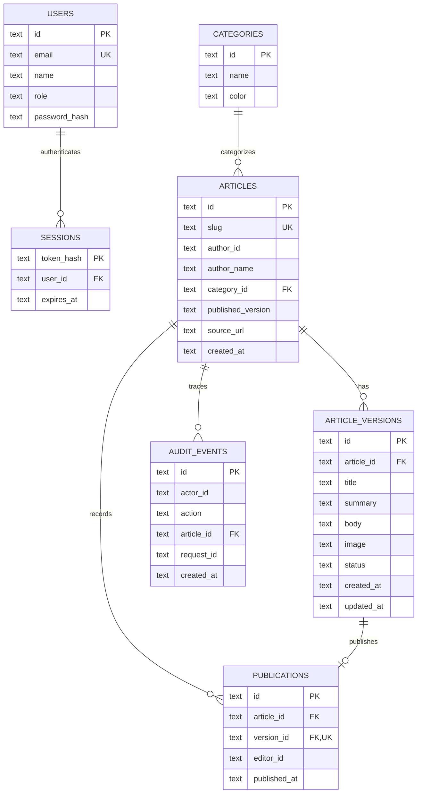

# Database

Production dùng **PostgreSQL trên AWS RDS**. Local dùng SQLite để chạy trực tiếp bằng Node.js 24. Dữ liệu nằm trong `storage/data/`, không đưa vào Git. Schema chung nằm trong `migrations/`; adapter kết nối nằm trong `backend/db.mjs`.

## Sơ đồ quan hệ



## Quy ước

- Tên bảng/cột dùng `snake_case`; khóa chính dùng UUID hoặc ID ổn định từ nguồn chính thức.
- Timestamp lưu dưới dạng chuỗi ISO 8601 UTC trong cả hai engine; giao diện hiển thị múi giờ Việt Nam.
- `users` và `sessions` phục vụ xác thực local bằng tài khoản thật do quản trị tạo. Production xác thực Cognito, không dùng mật khẩu local.
- `author_id`, `editor_id`, `actor_id` có thể là Cognito subject hoặc danh tính dịch vụ nhập nguồn, nên không khóa ngoại vào bảng tài khoản local.
- `articles.published_version` là con trỏ tới phiên bản công khai; nội dung chỉnh sửa tạo một `article_versions` mới.
- `publications.version_id` là duy nhất, ngăn tạo nhiều bản ghi khi retry xuất bản.
- Ghi thay đổi trạng thái, publication và audit trong cùng transaction.
- SQLite bật foreign keys và WAL; các transaction được tuần tự hóa. PostgreSQL dùng connection pool tối đa 10/process, advisory lock khi migrate và khóa hàng khi đổi trạng thái trên production.
- Index hỗ trợ lọc danh mục, tác giả, trạng thái bản thảo, lịch sử và thời hạn session.

## Nguồn dữ liệu thật

`sources/uth.json` là snapshot 30 bản ghi dẫn nguồn từ **Công đoàn UTH**, kèm URL và thời điểm truy xuất. Ảnh tương ứng nằm trong `frontend/assets/news/`. Đây là metadata tin có thật; nội dung đầy đủ vẫn ở website xuất bản gốc.

```powershell
# Khôi phục chính xác snapshot đã kiểm chứng, không cần mạng
npm run data:restore

# Nhập lại 30 tin hiện có từ API chính thức
npm run import:uth
```

Hai lệnh không tạo người dùng và không sinh bài giả. Khôi phục snapshot không ghi đè con trỏ xuất bản đã tồn tại.

Kiểm thử dùng database tạm riêng; fixture chỉ tồn tại trong quá trình test và không nhập vào database ứng dụng.
