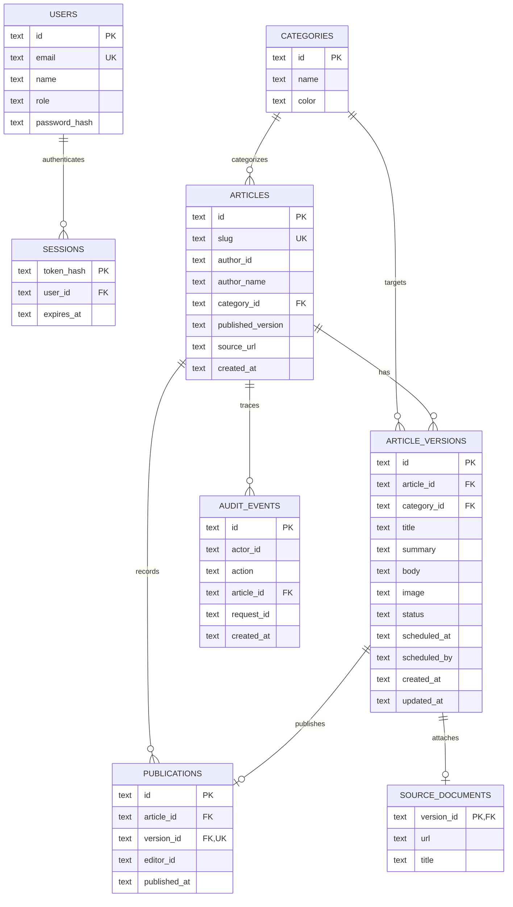

# Database

Thiết kế AWS dùng **PostgreSQL trên RDS**; bản Vercel hiện dùng PostgreSQL Neon riêng. Local dùng SQLite để chạy trực tiếp bằng Node.js 24. Dữ liệu nằm trong `storage/data/`, không đưa vào Git. Schema chung nằm trong `migrations/`; adapter kết nối nằm trong `backend/db.mjs`.

## Sơ đồ quan hệ



## Quy ước

- Tên bảng/cột dùng `snake_case`; khóa chính dùng UUID hoặc ID ổn định từ nguồn chính thức.
- Timestamp lưu dưới dạng chuỗi ISO 8601 UTC trong cả hai engine; giao diện hiển thị múi giờ Việt Nam.
- `users` và `sessions` phục vụ xác thực local bằng tài khoản thật do quản trị tạo. Production xác thực Cognito, không dùng mật khẩu local.
- `author_id`, `editor_id`, `actor_id` có thể là Cognito subject hoặc danh tính dịch vụ nhập nguồn, nên không khóa ngoại vào bảng tài khoản local.
- `articles.published_version` là con trỏ tới phiên bản công khai; nội dung chỉnh sửa tạo một `article_versions` mới. Khi xuất bản phiên bản mới hơn, phiên bản `published` trước đó chuyển sang `superseded` để không còn trùng trong danh sách biên tập.
- `publications.version_id` là duy nhất, ngăn tạo nhiều bản ghi khi retry xuất bản hoặc chạy scheduler đồng thời (`ON CONFLICT DO NOTHING`).
- `source_documents` lưu liên kết PDF gốc theo phiên bản, tách khỏi nội dung bài; migration `002_source_documents.sql` bổ sung bảng này. Xem lịch sử lấy đúng tài liệu của phiên bản đó.
- Migration `003_editorial_upgrades.sql` mở rộng trạng thái `article_versions.status` thêm `scheduled` và `superseded`, bổ sung `category_id` theo phiên bản cùng `scheduled_at`, `scheduled_by`, chỉ mục `idx_versions_scheduled`, và chuẩn hóa các bản `published` cũ.
- Ghi thay đổi trạng thái, publication và audit trong cùng transaction.
- SQLite bật foreign keys, WAL, `busy_timeout = 5000` và hàm `lower()` chuẩn hóa NFC tiếng Việt (`toLocaleLowerCase('vi')`); các transaction được tuần tự hóa. PostgreSQL dùng connection pool tối đa 10/process, advisory lock khi migrate và khóa hàng (`FOR UPDATE` / `SKIP LOCKED`) khi đổi trạng thái hoặc chạy scheduler trên production.
- Index hỗ trợ lọc danh mục, tác giả, trạng thái bản thảo, lịch sử và thời hạn session.

## Nguồn dữ liệu thật

`sources/uth.json` là snapshot 30 bài từ **Công đoàn UTH**, có tóm tắt và nội dung chính được diễn đạt lại sau khi đối chiếu nguồn, cùng 20 liên kết PDF gốc. Snapshot lưu URL, thời điểm truy xuất, mã băm nội dung/tiêu đề/PDF và phiên bản metadata cũ cần nâng cấp. Ảnh tương ứng nằm trong `frontend/assets/news/`. Toàn văn và tài liệu đầy đủ vẫn ở website xuất bản gốc.

```powershell
# Khôi phục chính xác snapshot đã kiểm chứng, không cần mạng
npm run data:restore

# Đối chiếu API/PDF chính thức và nhập các bài đã duyệt
npm run import:uth
```

Hai lệnh không tạo người dùng và không sinh bài giả. Khôi phục tạo phiên bản mới và giữ nguyên các snapshot lịch sử; chỉ chuyển con trỏ nếu bài chưa xuất bản hoặc đang dùng đúng phiên bản metadata cũ trong `replaces_versions`. Phiên bản biên tập độc lập không bị thay thế. Importer bỏ qua bài chưa duyệt hoặc nguồn đã thay đổi và báo `requiresContentReview`, không đưa nội dung rỗng vào database.

Kiểm thử dùng database tạm riêng; fixture chỉ tồn tại trong quá trình test và không nhập vào database ứng dụng.
