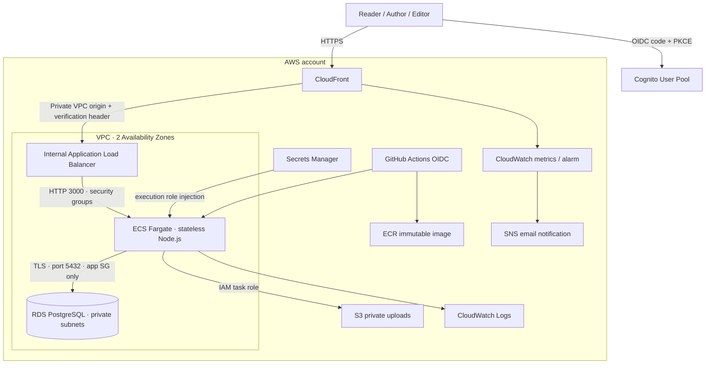

# Kiến trúc UTH Campus

**Trạng thái:** kiến trúc triển khai dự kiến đã có Terraform và được kiểm tra cấu hình. Chưa có bằng chứng tài nguyên AWS đã được tạo. Khi triển khai, bổ sung ARN, domain, subnet/AZ thực tế và sơ đồ xuất từ môi trường đã chạy.

## Lựa chọn thiết kế

- Node.js phục vụ frontend và API cùng origin. Nội dung bài lưu dạng văn bản, escape khi render để chặn HTML/script không tin cậy.
- Production dùng PostgreSQL làm nguồn trạng thái có thẩm quyền. SQLite chỉ phục vụ local và kiểm thử; không triển khai SQLite nhiều replica.
- Fargate task không lưu session người dùng hay ảnh trên ổ đĩa production. JWT Cognito được kiểm tra issuer, chữ ký, thời hạn, token use, client ID và nhóm quyền ngay tại API.
- Mỗi task có pool tối đa 10 kết nối DB. Cấu hình lớp học giới hạn 0–2 task; cần đối chiếu giới hạn kết nối RDS trước khi tăng scale.
- IAM task role chỉ đọc/ghi object của bucket riêng; execution role chỉ lấy secret cần thiết. Không đưa credential AWS vào image hoặc frontend.
- Secrets Manager cấp DATABASE_URL cho task. RDS bắt buộc TLS, client xác minh CA chính thức.
- Upload PNG/JPEG/WebP được kiểm tra chữ ký và giới hạn 5 MB. Đường `/media/` đọc qua backend; ảnh chưa gắn với bài công khai yêu cầu quyền biên tập phù hợp. Không cache dùng chung response media.

## Ranh giới mạng và phạm vi lỗi

- Người dùng chỉ truy cập HTTPS CloudFront. ALB nằm trong private subnet, chỉ nhận HTTP qua VPC origin từ managed prefix list origin-facing CloudFront và yêu cầu header xác minh riêng của distribution.
- Task ở public subnet để truy cập ECR, Cognito và S3 mà không dùng NAT Gateway cho cấu hình lớp học. Public IP không đồng nghĩa public inbound: SG task chỉ nhận port 3000 từ SG ALB.
- Database ở hai subnet không có Internet Gateway route; chỉ SG ứng dụng được vào 5432. RDS lớp học là **single-AZ**, chưa có HA database; hai subnet trong subnet group không biến instance thành Multi-AZ.
- Người dùng → CloudFront dùng HTTPS. CloudFront → ALB dùng VPC origin riêng tư; ALB → task dùng HTTP trong VPC và giới hạn SG. Đây là ranh giới TLS termination được lựa chọn, không tuyên bố mã hóa mọi chặng. Không cần mua tên miền để dùng URL CloudFront được cấp.
- Mặc định một task là một điểm lỗi compute; ECS thay task lỗi. Hai task có thể giảm gián đoạn compute, nhưng không loại bỏ lỗi single-AZ RDS.
- Khi origin lỗi, object cache còn hợp lệ có thể tiếp tục phục vụ đến khi hết TTL. Request chưa cache hoặc đã hết TTL có thể nhận lỗi. Giao diện HTML không được cấu hình cache dùng chung, nên không bảo đảm lần mở trang mới sẽ hoạt động chỉ nhờ API cache.

## Cache và tính đúng đắn

- Chỉ `/api/public/*` được CloudFront cache, TTL tối đa 30 giây, minimum TTL 0.
- Query string nằm trong cache key để không trộn danh mục, tìm kiếm hoặc workload baseline.
- Toàn bộ route còn lại dùng CachingDisabled, chuyển header xác thực tới origin. API biên tập trả `Cache-Control: no-store`.
- Browser không giữ public API quá hạn (`max-age=0`); shared cache có `s-maxage=30` và `must-revalidate`. Giới hạn 60 giây phải được đo trên distribution thật.
- Phiên bản đã công khai không bị sửa trực tiếp. Sửa bài tạo một draft mới; chỉ transaction xuất bản mới đổi con trỏ công khai.
- `Publication.version_id` duy nhất và retry cùng phiên bản trả thành công. Production khóa hàng phiên bản để tuần tự hóa các lần đổi trạng thái.
- Thay thế đã cân nhắc: Lambda/API Gateway giảm vận hành compute nhưng bổ sung vấn đề kết nối PostgreSQL, cold start và kiểm soát pooling. ECS phù hợp luồng HTTP và mô hình ALB được đề gợi ý.

## Tài liệu chính thức

- [CloudFront cache policy và minimum TTL](https://docs.aws.amazon.com/AmazonCloudFront/latest/DeveloperGuide/cache-key-understand-cache-policy.html).
- [CloudFront Authorization header](https://repost.aws/knowledge-center/cloudfront-authorization-header).
- [Cognito code flow với PKCE](https://docs.aws.amazon.com/cognito/latest/developerguide/using-pkce-in-authorization-code.html).
- [Cognito token endpoint](https://docs.aws.amazon.com/cognito/latest/developerguide/token-endpoint.html).

- [AWS CloudFront VPC origins: private ALB, security groups và region hỗ trợ](https://docs.aws.amazon.com/AmazonCloudFront/latest/DeveloperGuide/private-content-vpc-origins.html).
